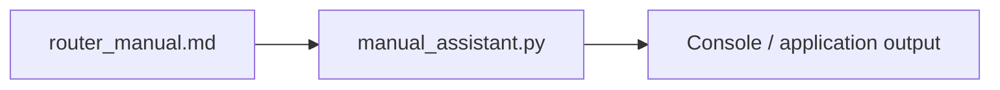

# Architecture — Technical Manual Assistant

## Inputs

- `sample_manuals/router_manual.md`

## Source files

- `src/manual_assistant.py`

## Output

This representation is intended for source navigation. It does not imply a production deployment or undisclosed components. The editable diagram is available as [`architecture.mmd`](architecture.mmd).
