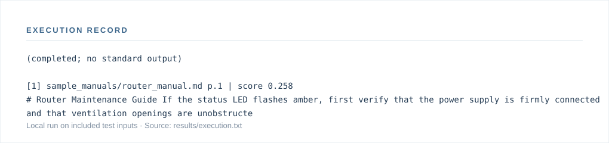

# Execution record — Technical Manual Assistant

**Status:** Local execution completed using bundled fixtures.  
**Python:** 3.13.5  
**Execution time:** 6.72 seconds in the packaging environment (not a standardized benchmark).  
**Method:** `python src/manual_assistant.py index sample_manuals --index-dir outputs/index`, `python src/manual_assistant.py ask outputs/index "What should I check when the status LED flashes?"`

## Observed output

**Raw output:** [execution.txt](../results/execution.txt)  
**Command records and SHA-256 digests:** [execution.json](../results/execution.json)

## Interpretation

Results were computed on the included test fixtures. They demonstrate one successful invocation, not measured generalization, comparative performance, system availability or operational readiness. If the fixtures or application are synthetic, values remain synthetic or simulated.
